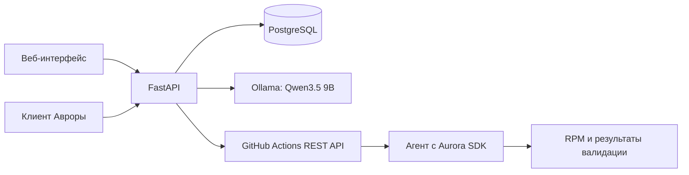

# Устройство проекта

## Компоненты

`routers/` принимает HTTP-запросы, Pydantic-схемы в `schemas/` проверяют входные
данные и задают публичные ответы. `crud/access.py` централизует поиск объектов
с проверкой владельца. `services/` содержит интеграции и последовательность
операций; `models/` — таблицы SQLAlchemy. `database.py` выдаёт сессию на запрос.
Коммиты выполняются явно; незавершённая транзакция откатывается при закрытии.

Синхронные эндпоинты FastAPI выполняются в пуле потоков. HTTP-вызовы имеют таймауты;
сессия БД освобождает соединение перед длительным сетевым ожиданием. Сейчас это
прототип для небольшой группы: очереди заданий, фоновой синхронизации всех прогонов
и нескольких процессов сервера нет. Состояние GitHub обновляется при просмотре
активного прогона; завершённый прогон читается из базы.

## Данные

- `users` — почта и хеш пароля.
- `access_sessions` — хеш Bearer-токена, владелец, срок действия.
- `pipelines` — общий каталог разрешённых процессов сборки одного проекта GitHub.
- `runs` — запуски пользователей, ветка, коммит, GitHub ID, состояние и результат.
- `jobs` — задачи/шаги GitHub Jobs API; уникальность по прогону, GitHub ID и попытке.
- `artifacts` — имена артефактов, без временных ссылок скачивания.
- `chats` — личные диалоги, необязательная ссылка на свой прогон, аренда генерации.
- `messages` — пары вопросов и ответов с временем создания.

Пайплайны общие для зарегистрированных пользователей; чаты и прогоны личные.
Публичных методов изменения каталога пайплайнов нет — используется `manage.py`.
Список чатов и прогонов ограничен 200 последними записями.

## Вход

Пароли проверяются Pydantic (8–128 символов), хешируются scrypt с отдельной солью.
Почта нормализуется к нижнему регистру. Сервер выдаёт случайный непрозрачный токен,
в базе хранит только SHA-256 от него. Срок по умолчанию 24 часа. Выход веб-клиента
удаляет текущую серверную сессию. Браузер хранит токен в `sessionStorage` текущей
вкладки; клиент Авроры — в памяти процесса. Нативный выход сейчас только очищает
локальную сессию; серверный токен остаётся до истечения срока.

Каждый приватный метод проверяет Bearer-токен и срок действия; доступ к объекту
другого пользователя возвращает 404. HTML-оболочки общедоступны, сами данные — нет.
Вход и регистрация ограничены 15 попытками в минуту на IP в пределах процесса.

## Запуск сборки и сбои

Веб-клиент заранее создаёт `Idempotency-Key` и сохраняет его до подтверждения.
Сервер создаёт `pending`, завершает транзакцию и однократно обращается в GitHub.
Внешние POST не повторяются автоматически. При повторе с тем же ключом возвращается
существующий локальный ID; другие параметры с тем же ключом дают 409.

| Статус | Значение |
|---|---|
| `pending` | Запрос сохранён, подтверждение GitHub ещё не получено |
| `queued` | GitHub подтвердил создание запуска |
| `in_progress` | Выполняется |
| `completed` | Завершён; `result` содержит результат |
| `submission_failed` | GitHub явно отклонил отправку |
| `submission_unknown` | Ответ потерян; GitHub мог создать запуск |

После разрыва сети POST не повторяется. Каждый запуск имеет уникальный `request_id`,
который передаётся как вход `portal_request_id` и включается в `run-name` процесса.
API GitHub 2026-03-10 возвращает `workflow_run_id`; также поддерживается прежний
ответ 204: тогда сервер находит запуск по точному `display_title = NIRS <request_id>`.
Потерянный ответ восстанавливается тем же способом при обновлении состояния.
Если запуск ещё не виден, локальная запись остаётся в ожидании. Новый POST не нужен.

Внешние идентификаторы хранятся в `external_run_id` (BIGINT), `external_job_id`,
`external_log_id` и `external_artifact_id`. Пайплайн указывает `workflow_file`.
Исторические миграции сохраняют старые имена колонок до миграции перехода на GitHub.
Каталог привязан к одному репозиторию из настроек; смена репозитория с существующей
историей требует отдельного переноса данных.

Проверка владельца не заменяет подтверждение GitHub: локальный ID и GitHub ID разные.
При синхронизации проверяются путь workflow, ветка и уникальный ключ запроса, сохраняются реальные задачи, результаты
и артефакты. Повторное обновление не дублирует задачи/артефакты.

## ИИ

FastAPI обращается к `/api/chat` Ollama с `stream=false`, `think=false`, контекстом
4096 и ограничением ответа 768 токенами. Имя модели задаётся настройкой, обучение
с нуля не требуется. Контекст истории и журналов ограничен по длине; целый большой
журнал в модель не отправляется. Это не RAG по документации и не дообучение.

Для разбора прогона создаётся связанный чат. В запрос включаются сведения о запуске
и окончания журналов до двух задач, приоритет отдаётся задачам с ошибкой.
Из известных форматов реквизитов и настроенного GitHub-токен удаляются значения; это не
полноценный универсальный сканер секретов. Используется локальная модель.

Сообщения сохраняются парой после успешного ответа. При ошибке/таймауте пара не
сохраняется. Аренда в `chats` предотвращает перемешивание ответов в одном чате;
после аварии она истекает через три минуты. Ограничитель разрешает одну генерацию
на процесс сервера; при занятости возвращается 429. При масштабировании потребуется
общая очередь вместо локального семафора.

Ответ модели — предположение, а не результат выполненного теста. Модель не вызывает
инструменты и не запускает команды. Для оценки качества нужны размеченные журналы
и отдельный эксперимент; успешный HTTP-запрос не доказывает корректность диагноза.

## Артефакты

API проверяет владельца прогона и передаёт ZIP из GitHub через сервер. GitHub-токен не выдаётся
браузеру и не передаётся в перенаправления на blob-хранилище. Разрешены только HTTPS
и ожидаемые домены GitHub и подписанного blob-хранилища. Журнал ограничен 2 МБ, архив — 256 МБ. Обрыв при передаче
архива приводит к неполному скачиванию: клиенту нужно повторить скачивание.

## Границы адаптации

Сайт, база, история и механизм анализа применимы к другим платформам. Для каждой
ОС необходимы собственный агент, SDK, процесс сборки и проверки. Реализован
конфигурационный сценарий Авроры; поддержка Android/iOS фактически не проверена.
Успешная сборка RPM и `sfdk check` не доказывают работу интерфейса на устройстве.
